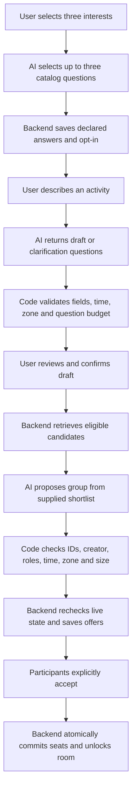

# Rally AI: proof and flow

## Evidence collected

### Live provider connection — passed locally by the project owner

The project owner supplied this output from `npm run ai:smoke`:

```json
{"status":"ok","model":"qwen3.7-flash","providerRequestId":"chatcmpl-00546274-6d23-905c-9665-a80a97d363b7","tokens":274}
```

The smoke script prints `ok` only after the adapter successfully receives a response, parses the model's text as JSON, and asserts its value equals `{"ok":true}`. This establishes working credentials, access to the selected model, and one valid JSON response. The token count is the provider's reported total usage, not a dollar charge or proof that thinking mode was enabled. The request ID is a correlation reference, not an independently verified execution receipt.

### Automated engine/adapter checks — 50 passed on final review

Command: `npm run test:ai`. Tests are in `test/formation.test.ts` and `test/zero-g.test.ts`.

Coverage includes valid drafts/groups, fabricated IDs, duplicate people, missing creator, nonconsenting inputs, incompatible times/zones/roles, unknown categories, extra output fields, clarification limits, no-fit versus outage, invalid JSON, oversized output, sanitized failures, timeouts and Fastify registration. These tests use controlled provider responses: they prove validator behavior, not the live model's accuracy.

Type-check, lint and build also passed. The full 74-test backend suite passed during implementation. A later full-suite rerun was blocked by this session's local TCP-listen restriction (`EPERM` in embedded PostgreSQL setup); the isolated AI test suite reran successfully.

## Reproduce the full live AI flow

```sh
cd backend
npm run ai:demo
```

This is an opt-in paid demo: normally four inference calls, with no automatic retry. It uses two explicitly labeled synthetic people and changes no database state. It calls the actual engine, not a separate mock path:

1. Ask 0G to select onboarding questions; assert the source is `ai`, not fallback.
2. Give a snack-run request with no start time; assert the model asks the catalog question `start_time`.
3. Supply the answer; assert the completed draft preserves the exact time, duration and group bounds.
4. Compose a group containing the synthetic host and guest; normal engine validators and demo assertions must pass.

The command prints safe inference traces with provider request IDs, each step's result, and a final `status: ok` only when all checks pass. Failure exits nonzero; inspect the step and failure code. Real model output can fail even though transport works. This demo passed all four live calls from the assistant session using a temporary curl transport bridge; native Node DNS was blocked. The same production engine, schemas and demo assertions ran against actual 0G responses. See the recorded results below.

## How Rally's flow works



Onboarding can also initiate a search against an existing activity; it converges on the same shortlist/composition step. Actual categories, question catalogs and eligible candidates are backend inputs, not model inventions.

Implemented here: `chooseOnboardingQuestions`, `parseActivity`, `composeGroup`, the 0G adapter, validators, traces, configuration, and Fastify's `app.formation` integration. Remaining backend work: authenticated routes, profile/activity persistence, retrieval, jobs/events, transactional offers, notifications and rooms. The diagram describes the complete intended product, not a claim that all those callers exist today.

Failure behavior: onboarding uses labeled catalog fallback; parsing falls back to an editable form; genuine no-fit waits for supply changes; provider outages and invalid output remain distinct failures. The backend must enforce budgets and attempt counts across requests and recheck live eligibility/capacity; the engine has no authority to allocate seats.

## Successful four-call live run — 5 November 2026

Recorded evidence: [ai-live-2026-11-05.json](evidence/ai-live-2026-11-05.json). Model: `qwen3.7-flash`, prompt version: `formation-v2`.

| Step | Verified output | Provider request ID | Reported tokens |
| --- | --- | --- | ---: |
| Onboarding | Chose allowed `availability` question, source `ai` | `chatcmpl-b59b0bf1-966c-99b5-ae6d-30b6e0b9634f` | 472 |
| Rally questions | Asked missing `start_time` | `chatcmpl-8d35ea54-9d47-9453-8b83-acb21f16c370` | 692 |
| Rally answers | Produced ready intent preserving supplied time, 40 minutes, and two-person group | `chatcmpl-ca67e559-8a87-9d81-bfdd-08bcfab3c942` | 1,436 |
| Composition | Proposed only `demo_host` and `demo_guest`, with valid roles and availability | `chatcmpl-ec6c180b-48f4-9f95-92a4-60a1f3c74afe` | 2,357 |

All four returned HTTP 200 and passed engine validators and demo assertions. Total reported usage for this successful run: 4,957 tokens. Latencies through the temporary bridge were approximately 24, 11, 19 and 30 seconds; these include orchestration overhead and are not pure provider benchmarks.

Two live failures informed the fix: the original onboarding prompt allowed the model to invent question IDs, and the model wrapped correct Rally JSON in a Markdown fence. Prompt v2 explicitly includes allowed IDs; the adapter unwraps only a complete JSON fence before normal strict validation. No validation rules were loosened. Credential-bearing transport files were deleted after use.

This is proof of the four AI tasks on one synthetic scenario. It does not establish broad model accuracy, production latency, configured reasoning mode, real-user consent, database integration or room creation.
