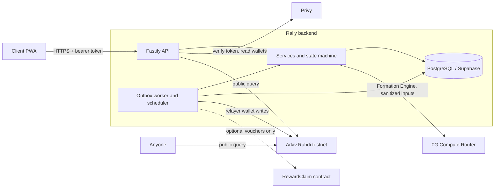
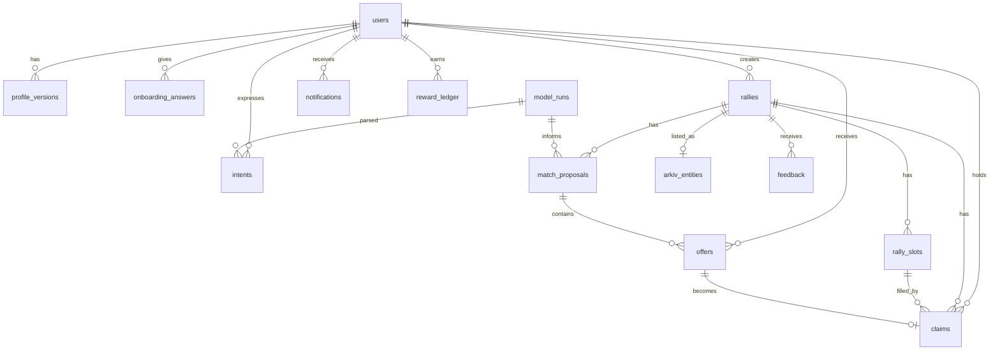
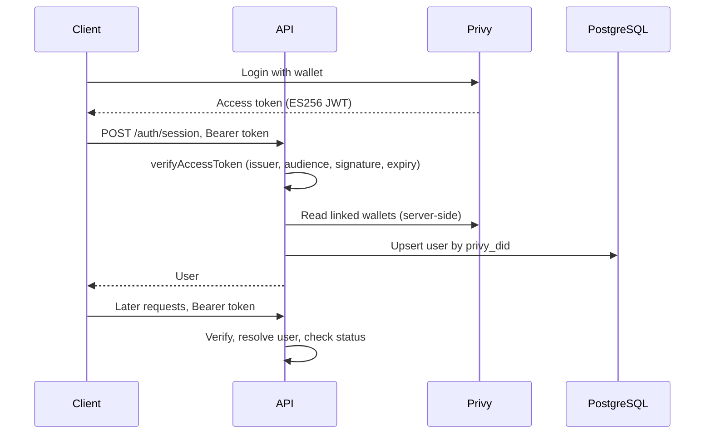
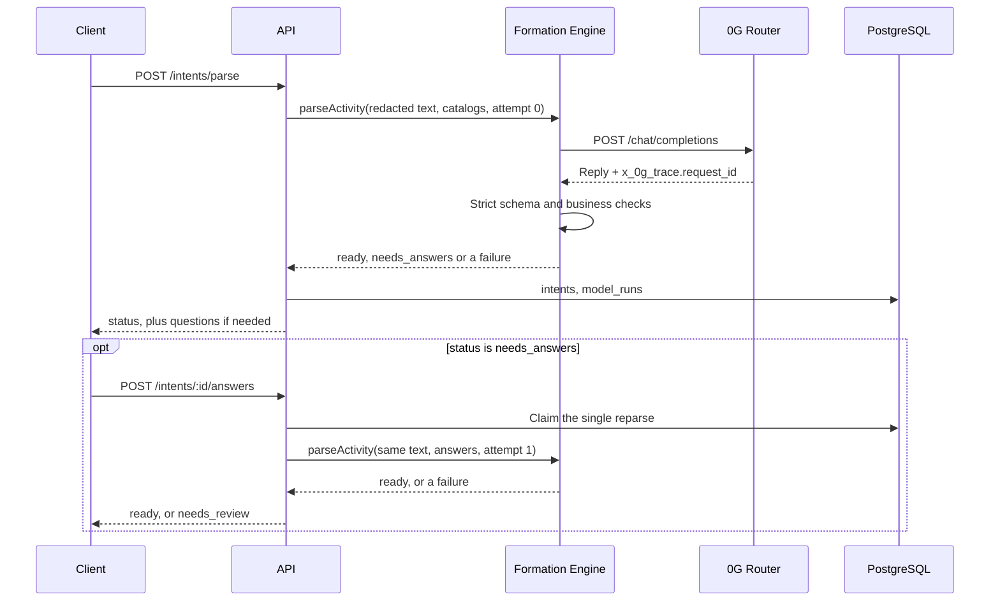
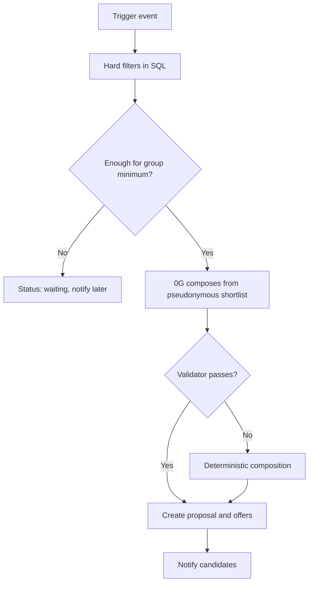
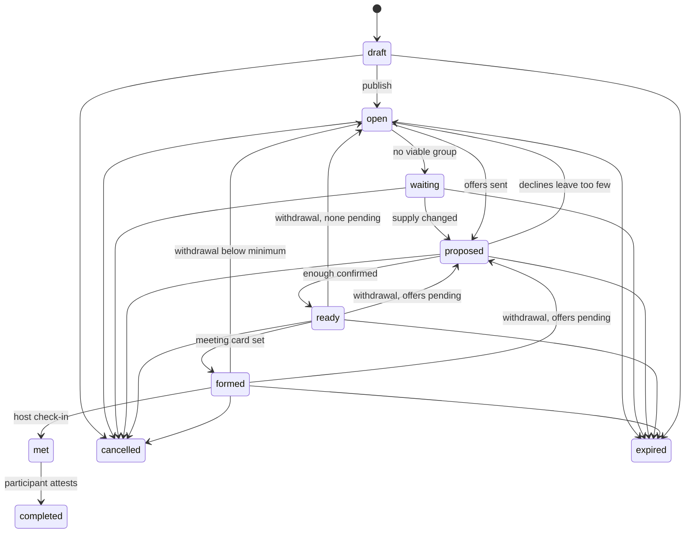
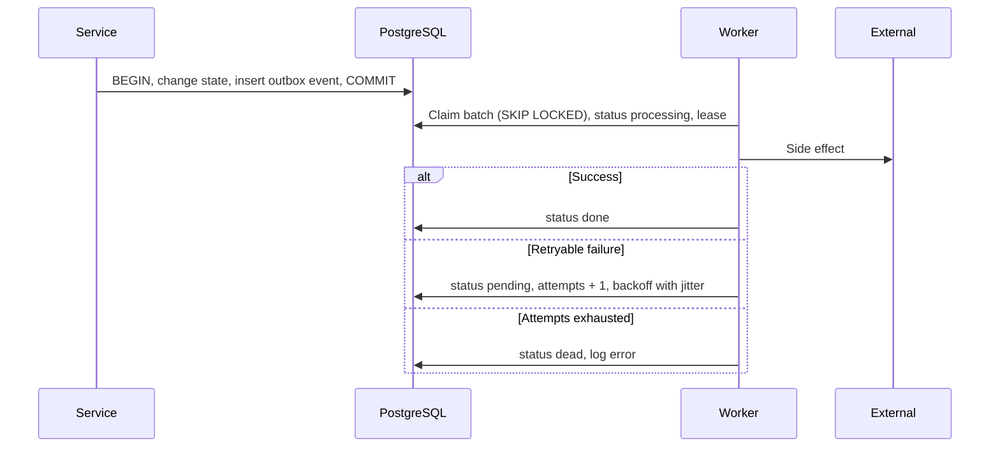
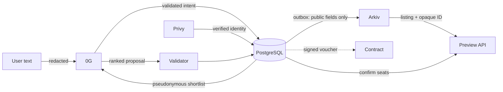

# Rally Backend Architecture

One TypeScript service owns all authority. External systems are adapters that can fail without
stopping the core product. Sections marked **Unverified** have not run against the real service.

## System overview



## Component responsibilities

| Component | Responsible for | Never does |
| --- | --- | --- |
| PostgreSQL (Supabase) | Private application data; authority for all transactional state | Serves as a public index |
| Arkiv | Public, queryable, expiring discovery listings | Allocates seats or stores personal data |
| 0G Compute | Intent parsing, question choice, group composition, explanations | Assigns seats, authorizes joins or writes to chain |
| Privy | Authentication and wallet identity | Determines Rally permissions |
| Smart contract (optional) | Reward claims against a funded pool | Controls matching or core flows |

## Backend architecture

`routes -> services -> repositories, domain, integrations`.

- **Routes** validate input and authenticate. **Services** own use cases and transactions.
- **Repositories** hold queries and take a `db` or transaction handle.
- **Domain** is pure logic: catalog, state machine, time and scoring.
- **Integrations** adapt Privy, Arkiv and 0G behind interfaces, so tests can use fakes.
- **Workers** run in the API process for the hackathon, using `WORKERS_ENABLED`. The design is safe
  with several instances because claims use `FOR UPDATE SKIP LOCKED`. Arkiv writes additionally use a
  PostgreSQL advisory lock so that only one writer uses the relayer nonce.

## Database architecture

The runtime uses `prepare: false` and `max_pipeline: 1` for Supavisor transaction-pooler compatibility.
Concurrent requests use separate pool connections rather than pipelining queries on one connection,
which reproduced lost replies and hanging session/readiness requests against the hosted pooler.
Single-connection tests cover concurrent response ordering, transactions and rollback recovery.



| Table | Purpose |
| --- | --- |
| `users` | Privy DID, server-verified wallet, status, matching consent |
| `profile_versions` | Append-only profile: interests, declared and inferred tags, evidence, availability |
| `onboarding_answers` | Answers to at most three questions |
| `user_blocks` | Hard filter for matching |
| `intents` | Parsed activity intent, including waiting interest; raw text stays private |
| `rallies` | The activity: window, zone, capacity, `open_seats`, status, `version`, private meeting point |
| `rally_slots` | Each seat and its role |
| `claims` | A held seat; this is the participant record |
| `match_proposals` | A composed group, its reasons, source and model run |
| `offers` | One candidate's invitation and consent |
| `feedback` | Attestations, vouches and encore wishes |
| `reward_ledger` | Off-chain points; idempotent, audited, policy-versioned |
| `notifications` | Persistent in-app inbox |
| `outbox_events` | Transactional outbox |
| `arkiv_entities` | Entity key, last transaction, sync state per rally |
| `model_runs` | 0G trace: request ID, model, provider, prompt version, latency, tokens, cost, outcome |
| `idempotency_keys` | Stored responses for retried commands |
| `reward_vouchers` | Issued claim vouchers and their nonces (optional feature) |

Decisions:

- The brief's `activities` and `activity_participants` are `rallies` and `claims`, matching the
  playbook. Its `proposals` are `match_proposals` plus `offers`, since consent belongs to a person.
- **`open_seats` and slots both exist on purpose.** Slots carry roles and let a unique index prevent
  double allocation. The counter is a fast read, guarded by a `CHECK` and updated in the same
  transaction.
- Offers do not reserve seats. More people may be offered than there are seats, which is how backups
  work, and a seat is taken only on acceptance.
- Enforced by the database: one active claim per slot, one active claim per user per rally, one
  pending offer per user per rally, and `0 <= open_seats <= capacity`.
- No soft delete. Lifecycle statuses and retained evidence serve that purpose.
- `optimistic rally version`: `version` increases with each change, and `PATCH` requires
  `expectedVersion`. Seat allocation uses row locks.

## API architecture

Base format is described in `CLAUDE.md`. Interactive documentation is served at `/docs`.

| Method and path | Auth | Purpose |
| --- | --- | --- |
| `GET /health`, `GET /health/ready` | Public | Liveness, readiness |
| `POST /auth/session` | Token | Verify Privy, upsert user |
| `GET /me` | Yes | Current user and profile |
| `PATCH /me/profile` | Yes | New profile version; triggers re-evaluation |
| `POST /me/blocks`, `DELETE /me/blocks/:userId` | Yes | Manage blocks |
| `GET /me/rewards` | Yes | Points balance and ledger |
| `POST /me/rewards/:id/voucher` | Yes | Signed claim voucher; optional feature |
| `POST /onboarding/questions` | Yes | Up to three questions |
| `POST /onboarding/complete` | Yes | Interests and answers; starts matching |
| `POST /intents/parse` | Yes | Natural language to `ready`, `needs_answers` or `needs_review` |
| `POST /intents/:id/answers` | Yes | The one reparse, with answers |
| `GET /intents` | Yes | My intents |
| `POST /intents/:id/activate`, `POST /intents/:id/cancel` | Yes | Keep or drop waiting interest |
| `POST /rallies` | Yes | Create a draft, or create and publish |
| `GET /rallies` | Yes | Rallies I created or joined |
| `GET /rallies/:id` | Yes | Details if creator, participant or offered |
| `PATCH /rallies/:id` | Creator | Update details, capacity, meeting point |
| `POST /rallies/:id/publish` | Creator | Draft to open |
| `POST /rallies/:id/cancel` | Creator | Cancel and release seats |
| `POST /rallies/:id/withdraw` | Participant | Release my seat |
| `GET /rallies/:id/participants` | Member | Participants |
| `GET /rallies/:id/room` | Member | Meeting card once formed |
| `POST /rallies/:id/check-in` | Creator | Host-attested presence |
| `POST /rallies/:id/feedback` | Participant | Outcome, vouch, encore |
| `GET /activities/preview` | Public | Arkiv discovery, cross-checked against PostgreSQL |
| `GET /matches`, `GET /matches/:id` | Yes | Proposals and wait state |
| `POST /matches/:id/respond` | Candidate | Accept or decline |
| `GET /notifications` | Yes | Inbox |
| `POST /notifications/:id/read`, `POST /notifications/read-all` | Yes | Mark read |
| `GET /internal/metrics` | Admin token | Outbox, sync and pilot metrics |

Expiry is run by the scheduler rather than a client route. Available seats change through acceptance,
withdrawal, cancellation and capacity updates.

## Authentication flow



- `@privy-io/node` verifies tokens. Set `PRIVY_VERIFICATION_KEY` to verify locally; otherwise the SDK
  fetches the JWKS.
- Identity comes from the token `sub`. Bodies are never trusted. An invalid token returns 401.
- If Privy's user API fails during session creation, the session still succeeds and any known wallet
  is kept. The optional wallet lookup has a five-second deadline and no SDK retries, below the
  browser's 20-second request timeout. Token verification still fails closed. A verified wallet is
  required later only for reward vouchers.

## Intent processing with 0G

All inference goes through the Formation Engine, built by the AI owner: `services/formation.ts`,
`schemas/formation.ts` and `integrations/zero-g.ts`. `backend/AI.md` and `AI_ARCHITECTURE.md` are its
contract. The backend supplies catalogs and hard-filtered shortlists, and owns persistence, retries and
consent. `services/formation-runs.ts` calls the engine and records each attempt in `model_runs`, so
intents and proposals can reference their evidence.



| Task | Budget | If it fails |
| --- | --- | --- |
| `onboarding` | 1 call | The engine uses catalog order, marked `fallback` |
| `intent` | 1 call, plus 1 reparse after answers | Editable form (`needs_review`), prefilled by fixed rules |
| `composition` | 1 call per viable group | See below |

- The model only chooses question IDs. Display text comes from the backend catalog.
- The attempt budget is stored on the intent and claimed by a conditional update, so clients cannot
  reset it, and concurrent retries cannot spend a second call.
- Direct identifiers (emails, phones, links, wallets) are redacted before text crosses the boundary.
- A rally starts at `windowStart` and runs `durationMin`. The engine validates a fixed time, and the
  candidate SQL filter enforces the same rule, so the two cannot disagree.

Composition outcomes:

- **Proposed:** after the engine's checks, the backend also checks seats and role counts, then rechecks
  live state in a transaction before creating offers.
- **`no_fit`:** a genuine answer from the model. The rally waits, and the shortlist's hash is stored, so
  the same people, seats and needs do not spend another call.
- **Failure** (`unavailable`, `timeout`, `invalid_output`):
  - `AI_REQUIRED=false`: the deterministic composer picks from the same eligible shortlist, marked
    `deterministic`. It cannot invent a person, and everyone still has to accept.
  - `AI_REQUIRED=true`: the outbox retries with backoff, and the rally stays pending. Use this for a
    sponsor demo, so a fallback cannot pass as AI.

`AI_ARCHITECTURE.md` says matching should remain waiting on failure. The product brief asks for
deterministic fallback behaviour. `AI_REQUIRED` gives both. **Confirm the default with the AI owner.**

Measured on the live Router, November 2026:

- **`response_format` breaks requests.** It returned `no_available_provider` (503) or `provider_error`
  (502) for every model tried, including ones the catalog lists as supporting it. The engine does not
  send it.
- **Latency was 7 to 24 seconds** per task with `qwen3.7-flash`. `AI_TIMEOUT_MS` defaults to 60 seconds,
  and `POST /intents/parse` waits on this, so clients need a real processing state.
- The Router's trace ID is `x_0g_trace.request_id`, which the adapter prefers over the response `id`.
  Billing reports `total_cost_usd_micro`, recorded as `usd_micro`.
- `X-0G-Provider-Trust-Mode: verified` returned `no_provider_for_trust_mode`. The adapter uses standard
  routing and makes no private or verified claim.

## Arkiv storage and querying

Public entity (schema `rally-mumbai.activity.v1`, owned by the relayer):

| Column | Indexed | Note |
| --- | --- | --- |
| `app` | yes | Application namespace |
| `event` | yes | Event tag |
| `opaqueId` | yes | Random `rly_...`, unrelated to the private ID |
| `category` | yes | Catalog value |
| `zone` | yes | Coarse zone |
| `startBucket` | yes | Hour, e.g. `2026-11-06T14` |
| `neededRole` | yes | Role category |
| `openSeats` | yes | Approximation |
| `minGroupSize` | no | |
| `status` | yes | `open`, `filling`, `full`, `closed` |
| `$expiresAt` | system | Replaces the playbook's `expiresAtBlock` |

- Writes only come from the outbox, after commit. The `arkiv.sync` handler reads current PostgreSQL
  state, then creates, patches or deletes, so retries converge and replays are harmless.
- **No duplicate entities after a crash.** Before creating, the handler queries by `opaqueId` under
  the relayer, and adopts an existing entity's key.
- Public status never reveals private lifecycle. `proposed`, `ready` and similar map to coarse values.
- Reads use `.ownedBy(relayer)`, the indexed filters, `limit`, and key-based cursors, because `offset`
  can repeat or miss rows during writes.
- A preview cross-checks each listing against PostgreSQL by `opaqueId`, and removes stale ones.
- A reconciler repairs drift: unsynced rallies are re-enqueued, and active rallies with no entity are
  created. Terminal rallies have their entities deleted.
- Private and sensitive rallies never get an entity.

### Verified from SDK 1.0.1 source and documentation

Rabdi: chain ID 7794095, 2-second blocks, gas in tGLM. 32 attributes per entity (31 with a named
schema), 128-byte strings, 128 KiB of `bytes` per create or patch, 100 rows per page, maximum lifetime
of 7,884,000 blocks. There is no `updateEntity`: use `patchEntity`. Patches keep expiry, and
`extendEntity` cannot shorten it. Expiry emits no event. Entities are publicly writable under any
schema name, so filter by owner.

### Needs confirmation from the Arkiv team

The team's informal statements are recorded as such, and nothing depends on them.

| Topic | Stated by team | Documentation or status |
| --- | --- | --- |
| Query page size | 40 | Docs and SDK say 100, and live Rabdi accepted 100. `ARKIV_QUERY_PAGE_SIZE` defaults to 40 |
| Query latency | About 2 seconds | 200 to 630 ms in single live queries; unmeasured under load. Writes took about 6 seconds |
| Attributes | 32 | Matches docs; 31 with a named schema |
| Wallet storage | About 40 pages per user | Not documented; a shared relayer may reach any wallet limit sooner than a per-user estimate suggests |
| Testnet cost | Not a concern | Not measured |
| Community RPC | May be faster | Not tested. `ARKIV_RPC_URL` allows an override |

Still to validate: maximum entity size in bytes, wallet-level storage limits, write throughput per
relayer, transaction costs, query latency under load, community RPC reliability, and expiry and
deletion semantics in chain history.

## Matching architecture

Two triggers, one engine: `rally.published` and `user.onboarded`. Availability changes, withdrawals
and new supply also enqueue re-evaluation.



Hard filters: same category; window overlap covering the duration; allowed zone; rally status, expiry
and seats; opted-in active user; no block in either direction with any current member; no existing
claim, pending offer or earlier offer on this rally; no overlapping active commitment.

A model call happens only for a viable group. Anyone offered a seat leaves the candidate set, and a
`no_fit` is remembered by shortlist hash, so a rally spends another call only when its feasible
candidates have actually changed, as the playbook requires.

The deterministic score follows the playbook, as a heuristic and not a probability: feasibility 45%,
complementary fit 30%, acceptance likelihood 15%, prior mutual encore 10%. It orders the shortlist, and
picks the group when the engine is unavailable.

Everyone reaches the engine under an alias (`m1` for current members, `c1` for candidates), mapped back
server-side, so real user IDs never cross the boundary. Only interests, eligible roles, zone and
availability are sent. Declared skills and display names are not.

## Atomic acceptance and reservation

```mermaid
sequenceDiagram
  participant U1 as User A
  participant U2 as User B
  participant DB as PostgreSQL
  U1->>DB: BEGIN, lock user, lock rally FOR UPDATE
  U2->>DB: BEGIN, lock user, wait for rally lock
  U1->>DB: Validate offer, status, expiry, schedule
  U1->>DB: Pick open slot, insert claim, open_seats - 1
  U1->>DB: Update offer, state; write outbox and notifications
  U1->>DB: COMMIT
  DB-->>U2: Rally lock acquired
  U2->>DB: Validate: no open seat
  U2->>DB: ROLLBACK
  DB-->>U2: 409 RALLY_FULL
```

- Lock order is user, rally, offer, so deadlocks cannot form between use cases. Locks are
  `FOR NO KEY UPDATE`, because plain `FOR UPDATE` blocks the foreign key checks of other transactions.
- Idempotent: an already accepted offer returns the same claim. Declining is similar. An accepted
  offer cannot be declined here; use withdraw.
- Partial unique indexes are the final defence; violations map to 409.
- Any error rolls back everything, including the outbox events.
- Arkiv is never consulted.

State transitions after a response: `open_seats = 0`, or no pending offers with claims at the group
minimum, moves the rally to `ready`. `ready` moves straight to `formed` if a meeting point exists;
otherwise it waits for the creator to set one. No pending offers and too few claims reopens the rally
and triggers another match.

## Activity state machine



## Outbox and workers



- At-least-once delivery, so every handler is idempotent. Deduplication uses a unique `dedupe_key`
  on the event, deterministic targets for writes, and unique keys on notifications and rewards.
- An expired lease returns a crashed worker's event to `pending`.
- A dead Arkiv event only marks the listing as out of sync, and the reconciler retries later.

| Outbox event | Handler | Playbook domain event |
| --- | --- | --- |
| `rally.published` | Matching for the rally | RallyPublished |
| `user.onboarded` | Matching for the user | UserOnboarded |
| `match.reevaluate` | Matching for a rally or user | ParticipantWithdrew, availability changes |
| `arkiv.sync` | Make the listing match PostgreSQL | RallyPublished and every seat or status change |
| `vouch.verified` | Profile evidence and capped points | VouchVerified |

MatchProposed, MatchAccepted and RallyCompleted need no event: their notifications are written in the
same transaction as the change, and seat revalidation happens synchronously on acceptance.

Scheduler jobs: expire rallies, offers, proposals and intents; reconcile Arkiv; delete old outbox rows,
idempotency keys and read notifications.

## Notifications

Notifications are written to the inbox in the same transaction as the state change, so they cannot be
lost. Clients poll `GET /notifications`. A unique `dedupe_key` prevents duplicates on retry.

## Smart contract responsibilities

Core Rally needs no contract. `RallyLedger` and `RallyToken` on Arc Testnet hold a public copy of RALLY
points and dispute rulings. Postgres stays the source of truth: a scheduler job queues applied entries,
rulings and policies, and the outbox worker writes them through `integrations/arc`. Entries wait while
`ARC_LEDGER_ENABLED=false`, then backfill. Nothing on-chain affects matching. See `contracts/README.md`.

The older `RewardClaim` is not deployed, and vouchers stay off behind `REWARDS_CLAIMS_ENABLED`.

## Errors and retries

| Failure | Behaviour |
| --- | --- |
| Privy token rejected | 401; a wallet address from the UI is never trusted |
| 0G slow or unavailable | Timed fallback to the editable form; no invented matches |
| Arkiv unavailable | Preview returns `available: false` with a notice; invites still work |
| Last-seat race | One transaction and unique claim; loser gets `409 RALLY_FULL` |
| Notification failure | Inbox is transactional; there is no separate delivery to fail yet |
| Participant withdraws | Seat reopens, others notified; never auto-accepted |
| Prompt injection or PII | User text treated as data; schema validation; redaction |
| Sensitive category | Forced private; never on Arkiv |

Retry rules: exponential backoff with jitter for 429, 5xx and network errors. Authentication,
validation and insufficient-balance errors are not retryable for 0G; they fall back immediately.

## Privacy boundaries

| Data | PostgreSQL | Arkiv | 0G |
| --- | --- | --- | --- |
| Privy DID, wallet | Yes | Never | Never |
| Interests, answers | Yes | Never | Pseudonymous, minimal |
| Raw intent text | Yes | Never | Redacted, for parsing only |
| Exact meeting point | Yes, members only once formed | Never | Never |
| Category, broad zone, hour | Yes | Public rallies only | Yes |
| Offers, consent, feedback | Yes | Never | Never |

TTL removes entities from live queries, but not from chain history, which is why only public-safe data
is ever written.

## Data flow



## Deployment

- One Node.js process runs API and workers. Run `npm run build`, `npm run db:migrate:prod`, then
  `npm start`. Ship `drizzle/` with `dist/`.
- Set `DATABASE_URL` to Supabase's transaction pooler and `DATABASE_MIGRATION_URL` to its
  session pooler. The direct host is IPv6-only.
- Use `/health` for liveness and `/health/ready` for readiness.
- Set `TRUST_PROXY=true` behind your own proxy, or per-IP rate limits apply to the proxy.
- Row level security is on for every table with no policies, so Supabase's Data API exposes nothing.
  The service connects as the table owner and bypasses it. **Never give it a role that does not own
  the tables, and do not add permissive policies.** A test fails if a new table lacks RLS.
- `/docs` serves the API description publicly. It holds no data, but block it at your proxy if you
  would rather not publish it.

## Environment variables

Blank counts as unset. `.env.example` has a commented copy.

| Variable | Default | Purpose |
| --- | --- | --- |
| `NODE_ENV` | `development` | `production` makes CORS and Privy settings mandatory |
| `HOST`, `PORT` | `0.0.0.0`, `3000` | Listen address |
| `LOG_LEVEL` | `info` | Pino level |
| `DATABASE_URL` | required | Runtime connection |
| `DATABASE_MIGRATION_URL` | `DATABASE_URL` | Migrations only |
| `DATABASE_POOL_MAX` | `10` | Connection pool size |
| `CORS_ORIGINS` | none | Exact browser origins, comma-separated |
| `TRUST_PROXY` | `false` | Honour proxy headers |
| `RATE_LIMIT_MAX`, `RATE_LIMIT_WINDOW_MS` | `300`, `60000` | Per-IP limit |
| `SHUTDOWN_TIMEOUT_MS` | `15000` | Forced exit deadline |
| `WORKERS_ENABLED` | `true` | Run outbox and scheduler in this process |
| `OUTBOX_POLL_MS`, `SCHEDULER_INTERVAL_MS` | `1000`, `30000` | Worker pacing |
| `ADMIN_API_TOKEN` | none | Enables `GET /internal/metrics`; 32+ characters |
| `EVENT_ZONES` | three venue zones | Allowed zones |
| `EVENT_TIME_ZONE` | `Asia/Kolkata` | Resolves "tonight" when the client sends no zone |
| `EVENT_END` | 14 days ahead | Activities must end before this |
| `OFFER_HOLD_MINUTES` | `30` | How long an offer stays open |
| `PRIVY_APP_ID`, `PRIVY_APP_SECRET` | none | Required in production. **Secret** |
| `PRIVY_VERIFICATION_KEY` | none | Verify tokens locally |
| `ZERO_G_API_KEY`, `ZERO_G_MODEL` | none | Without both, deterministic fallbacks. Key is **secret** |
| `AI_REQUIRED` | `false` | `true` fails startup when the two above are missing, and retries matching through outages rather than falling back |
| `AI_TIMEOUT_MS` | `60000` | Then fall back |
| `AI_MAX_OUTPUT_TOKENS` | `4096` | Includes reasoning tokens |
| `ARKIV_PRIVATE_KEY` | none | Relayer wallet. Without it, discovery is off. **Secret** |
| `ARKIV_ACCESS_KEY` | none | RPC key. Without it, the heavily limited public endpoint |
| `ARKIV_RPC_URL` | Rabdi | Override, e.g. community RPC |
| `ARKIV_APP`, `ARKIV_EVENT`, `ARKIV_SCHEMA_NAME` | Rally values | Namespacing |
| `ARKIV_QUERY_PAGE_SIZE` | `40` | Up to 100 |
| `ARKIV_QUERY_TIMEOUT_MS` | `5000` | Then preview shows a notice |
| `ARC_LEDGER_ENABLED` | `false` | Writes RALLY history to Arc Testnet |
| `ARC_RPC_URL`, `ARC_CHAIN_ID`, `ARC_LEDGER_ADDRESS`, `ARC_TOKEN_ADDRESS` | none | Required when enabled |
| `ARC_RELAYER_PRIVATE_KEY`, `ARC_REF_SECRET` | none | **Secret**. Required when enabled |
| `ARC_EXPLORER_URL` | `https://testnet.arcscan.app` | Profile link |
| `REWARDS_CLAIMS_ENABLED` | `false` | Optional voucher signing |
| `REWARD_SIGNER_PRIVATE_KEY` | none | **Secret** |
| `REWARD_CLAIM_CONTRACT`, `REWARD_CHAIN_ID`, `REWARD_TOKEN_UNITS_PER_POINT` | none | Required when enabled |
| `REWARD_VOUCHER_TTL_MINUTES` | `60` | Voucher lifetime |

## Verification status

| Area | How it was checked |
| --- | --- |
| PostgreSQL, seat races, idempotency, outbox | Real PostgreSQL 18 with real concurrent requests |
| Privy token verification | Real SDK with locally signed ES256 tokens |
| Privy credentials | Live: junk token rejected, and the API accepted the app ID and secret |
| Privy login with a real user, and wallet lookup | **Unverified**: needs a real login from the client. Faked in tests |
| 0G inference in the main flow | Live: questions, intent parsing and composition through the Formation Engine, with request IDs (`npm run smoke:journey`) |
| Formation Engine alone | Live, by the AI owner: `backend/AI_PROOF.md`, `npm run ai:demo` |
| Private or verified 0G routing | **Unverified**; verified routing currently returns no provider. Do not claim it |
| Arkiv queries and writes | Live on Rabdi: create, read, patch, extend, delete (`npm run arkiv:smoke -- --write`) |
| Full journey | Live 0G and Arkiv on a throwaway database, with simulated login |
| Supabase | Live: migrations through the session pooler, server readiness, row and advisory locks through the transaction pooler, and the `anon` role seeing no rows. Seat races ran on PostgreSQL 18 locally, not on Supabase's 17 |
| RewardClaim contract | Foundry unit and fuzz tests, local Anvil deployment, shared signature fixture |

## Not implemented

The playbook marks these optional or describes them loosely. They were left out rather than stubbed.

- Web Push, and SSE. In-app notifications use polling, which the playbook allows.
- Chat in the temporary room. The room is the meeting card and member list.
- Encore prefill of a future rally. Mutual encores feed the deterministic score only, because the
  Formation Engine's strict schema has no field for them.
- Reward corrections and vouch disputes, which need an admin flow. Flagged vouches earn nothing.
- "N exploring" counts on preview cards. Cards show open seats.
- Admin tooling beyond `GET /internal/metrics`.

## Assumptions needing confirmation

0G:

- Private or verified routing must be tested with a real key before it is claimed.
- Model availability and JSON mode, read from the live catalog, may change.
- Whether `response_format` failing is a temporary Router issue or expected behaviour.
- Model quality: the 30 labeled evaluations the playbook calls for have not been run.

Others: see the Arkiv table above. Which chain and asset any reward contract targets is undecided.


## Matching regression guarantees

The shortlist holds `MAX_GROUP - 1` candidates (currently 11), so groups of 10–12 can reach their minimum with the host included. Both retrieval and transactional revalidation use the same bound.

A cached no-fit is keyed by candidate matching data, current member IDs/roles, available roles, activity constraints and group bounds. Changing interests or availability triggers a new composition; unchanged input and display-name-only changes reuse the existing no-fit. The hash is private and stores no raw profile data.

Host publication checks the same schedule-conflict rule as accepting an invitation. Creation with immediate publication, later draft publication and published schedule edits take the user's lock before the Rally lock, so concurrent host actions and acceptance cannot double-book that person. Overlapping drafts remain editable; publication returns `409 SCHEDULE_CONFLICT` until the conflict is resolved. Adjacent non-overlapping windows are allowed.

The optional `PRIVY_VERIFICATION_KEY` override is validated at startup as an ES256 SPKI PEM public key. Leave it blank to use Privy's app JWKS endpoint. An invalid override otherwise appears as a generic invalid-token error from the SDK, even for valid frontend tokens. The frontend Privy app ID must match `PRIVY_APP_ID`; a valid-format key from another app will still fail signature verification.


## Personalized questionnaires (formation-v6)

Onboarding catalogs depend on the three selected interests. Gaming asks which game, building asks a declared role, workshops ask a topic, food asks sit-down/takeaway, coffee asks social energy, and exploring asks venue/nearby. Responses may use offered values or custom text of up to 120 characters. Offered values use the existing structured keys; custom answers use `custom_<category>` in the existing JSON preferences. Only an offered build role becomes a declared skill. Legacy generic questions and answers remain accepted. The three-question maximum still applies. Fallback question selection uses the same interest-specific catalog, explicitly marked fallback.

Activity parsing receives declared interests, allowlisted roles and allowlisted structured preferences and redacted category-specific custom preferences, never the full profile or unrelated free-form notes. Current answers override model/default preferences. The model selects relevant activity questions and can return structured preferences on the draft. These preferences are shown as editable controls before publication and are persisted on intents and rallies. A supplied category change discards unrelated preferences.

Activity clarification uses model-tailored wording for the specific request, with category templates when wording is omitted. Optional `questionTexts` keys must belong to the selected question IDs, and each text is limited to 200 characters. The prompt preserves question purposes and offered option meanings, skips known details, and avoids unsupported matching criteria. Direct identifiers are redacted before wording is saved. The fallback classifier recognizes jogging (including “joggin”) and running as wellness. Question IDs, answer validation, the three-question limit and the single reparse budget stay the same. Wording is saved with the draft, so existing drafts retain the questions already shown. No extra inference call or schema migration is needed.

Candidate retrieval filters explicitly conflicting activity/profile preferences before the shortlist limit, using waiting-intent preferences in preference to profile defaults. Unknown or `any` values remain eligible; this does not establish skills or guarantee a fit. The engine checks compatibility again, and acceptance reuses current eligibility rules under the user/Rally locks. Preferences never enter public Arkiv records.

`npm start` runs `db:migrate:prod` through its `prestart` lifecycle before serving requests and stops if migration fails. Render must use `npm start`, with `drizzle/` alongside `dist/` and `DATABASE_MIGRATION_URL` configured for the session pooler. Direct `node dist/index.js` startup skips migration; multiple instances or concurrent deployments must use a serialized migration step. Migration `0005_lyrical_moira_mactaggert.sql` adds non-null JSON preference columns to intents/rallies with empty-object defaults and preserves existing rows. Run `npm run ai:personalization` for four live, synthetic 0G checks. Frontend questionnaires render backend option lists; the plan-review screen allows preference edits. Future preference keys/options must be kept in step with its review option list.

Suggested options remain available alongside custom input. Profile supports adding, editing and clearing preferences for all activity categories. Plan-specific choices override profile defaults for that category. Custom preferences inform AI compatibility assessment rather than SQL equality; deterministic fallback uses the existing hard eligibility rules and cannot assess free-text compatibility. No claim is made of calibrated matching quality or dietary/medical safety. Existing profiles are not retroactively interpreted from historical free-text answers.

## Image evidence feasibility (diagnostic only)

`npm run ai:vision:probe` tests public sample photos against 0G, using the existing adapter with a diagnostic transport that injects image content parts. The production adapter and Formation Engine still send text only; photo uploads, image assessment, auto-completion and proof-gated rewards are not implemented. The live catalog lists the current `qwen3.7-flash` as text-only, and an image request returned HTTP 400. `gemini-2.5-flash-lite` passed seven public-photo checks; the suite reported 1,532 USD micro ($0.001532). Qwen2.5-VL had frequent malformed JSON responses in this probe. See `evidence/VISION_PROBE_2026-11-06.md` for the requests, failures, costs and limits. These tests establish transport and basic image assessment only: they do not verify attendance, photo freshness, account identities, resistance to fraud or private/attested execution.


## Automatic completion and optional group-photo rewards

For newly created Rallies, `PROOFS_ENABLED=true` (default) stores `proof_flow=true`. Existing rows
migrate to false, preserving historical feedback, points and old dispute behavior. A formed new
Rally completes at `meetTime + durationMin + 15 minutes`, independently of host check-in or feedback.
The scheduler checks completion before expiry and never expires a formed proof-flow Rally instead.
The completed member roster is frozen under the Rally lock. New joins, cancellations and withdrawals
stop at the meeting cutoff. Completion does not set arrival or physical-presence timestamps.

A completed group member can submit 1–3 JPEG/PNG photos and an optional note within 48 hours. The
endpoint limits submissions to six per authenticated user per hour (shared venue IPs do not share
the allowance), requires a stable idempotency key, validates actual bytes, rejects animation/oversized
images, limits decoding to 20 megapixels, strips metadata and resizes to 1024 pixels. At most three
submissions per Rally, two inference attempts per submission. Duplicate request keys never bill twice.
Images are private, RLS-protected JSON data in `rally_proofs`, bounded to at most 1 MB normalized per
photo; this pilot storage avoids new bucket credentials. Photos and notes are deleted after 30 days,
while private hashes and decision metadata remain. Move image bytes to private object storage when
volume justifies it. Neither photos nor raw image hashes enter Arkiv or public chain data.

`proof.assess` runs asynchronously through the existing FormationRunner, typed 0G image transport,
`ZERO_G_VISION_MODEL` (default Gemini 2.5 Flash-Lite) and `model_runs`. It sends redacted activity/note
context and image parts, not names, wallets, member IDs or signed asset URLs. AI returns bounded
observations; deterministic rules require assessable, matching, visibly grouped, non-duplicate
evidence. Unclear evidence requests clearer photos; outages retry once and become `unavailable`,
never approval. Per-proof leases bound duplicate calls and expired leases are recovered by the
scheduler. Per-image advisory locks serialize accepted-image reuse checks across different groups.

One accepted submission atomically awards every frozen member `RallyCompleted` (default 10) using
one unique Rally/user key. The amount and immutable policy version are pinned at submission.
Completion rewards deliberately do not apply legacy per-person daily/counterparty caps: the group
receives the same amount in full. Existing legacy reward actions retain their caps. No individual
photo, vouch or second participant confirmation is required. No rewards are awarded on automatic
completion alone. Vouches add profile evidence but not points in this flow. New-flow check-in and
complaint paths are disabled, and silence cannot create an absence penalty. The penalty scheduler
applies only negative pending entries. Existing history and previously earned points are preserved.

The source contract appends action 8 to its old eight actions. It is **not deployed** by this change.
`ARC_COMPLETION_REWARDS_ENABLED=false` keeps new completion entries safely pending on-chain while
points work in the app. Legacy chain entries continue syncing. After an authorized new deployment,
configure its ledger/token addresses and corresponding policies before enabling the flag. The
worker rechecks applied state and accepted proof; evidence commitments are salted per recipient.
Contract history is immutable; no cash payout or generic reversal is introduced. See contracts/README.md.

`test/proof-live.test.ts` is skipped by default. `RUN_LIVE_PROOF=true npm test -- --run
test/proof-live.test.ts` uses a public NASA photo, synthetic group and throwaway database with real
0G. It proved acceptance and 10 points for both members with one inference and no duplicate payout;
evidence is in `evidence/proof-full-flow-live-2026-11-06.json`. This does not establish photo freshness,
identities or fraud resistance; downloaded/staged/modified photos remain a known limitation.


### Matching triggers and custom preferences

New plans default to two people total (host plus one guest). The intent schema and fallback use
`groupMin = groupMax = 2`; explicit user sizes/ranges are retained. The intent prompt omits unspecified
group bounds and does not spend a clarification question on the default size. Existing drafts and
published Rallies keep their saved sizes.

New onboarding visibly defaults Receive Rally invites to on; users can disable it before submitting.
The client initially offers 12 hours and lets the user choose another window; Profile can change or
pause matching and edit availability. Existing users keep their saved opt-in choice. Backend callers
that omit optInMatching default to true and must still supply availability.

Publishing (not saving a draft), onboarding, enabled profile changes (including new verified-vouch
evidence), and waiting-intent activation
feed the same background matching engine. The user scan processes five Rallies per job, using a
(window_start, id) cursor to enqueue subsequent pages. New publications can invite an idle user
without any browser request. Invitations and inbox notifications are committed together and never
join someone automatically. Declining also checks other Rallies; cancellations, expirations,
withdrawals and host schedule edits recheck people whose schedules were freed.

Custom preferences stay in the existing JSON columns, with allowlisted custom_<category> keys and
120-character values; no migration is needed. Suggestions retain exact structured validation. Custom
text is redacted before model calls and never enters public Arkiv records. Changing or removing a
category's custom profile preference closes pending invitations in that category and queues both
sides for reevaluation. Closed invitations remain closed under the existing one-offer-per-Rally rule.
The engine also checks preference snapshots again after composition before creating invitations.

Profile has one free-text preference box (4,000 characters), with declared skills and received
vouches shown separately. Existing category preferences appear as readable lines; `any` adds no
line. Saving converts those matching preferences to `matching_notes` in the existing private JSON
column; unrelated private fields remain separate. New category preferences appended later appear
in the same box. No migration or extraction call is needed. Notes are redacted before inference,
treated as untrusted context in parsing/composition, and never copied wholesale into activity
preferences or public Arkiv records. Parsing can extract relevant category preferences into a draft;
explicit activity choices take precedence. Deterministic fallback cannot
interpret notes; availability, opt-in and consent still apply.

The page refreshes every 15 seconds while visible, preserving unsaved edits. Saves include
`expectedProfileVersion`; a stale draft receives 409 instead of overwriting a background update.
Cancel edits loads the latest profile. Editing or clearing preferences queues matching when opted
in. Vouches do not overwrite explicit preferences, and inferred tags are recorded evidence, not
additional declared interests or a learned preference model.
