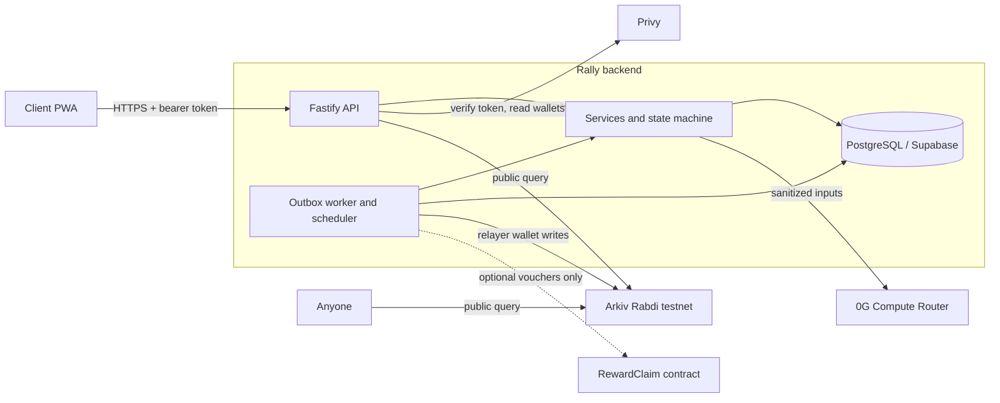
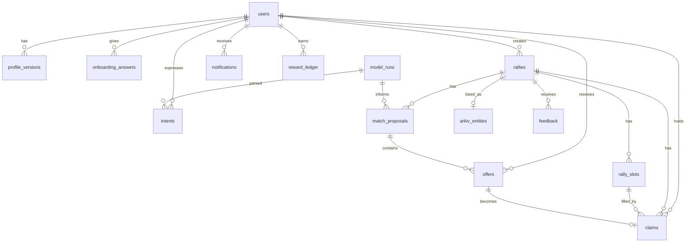
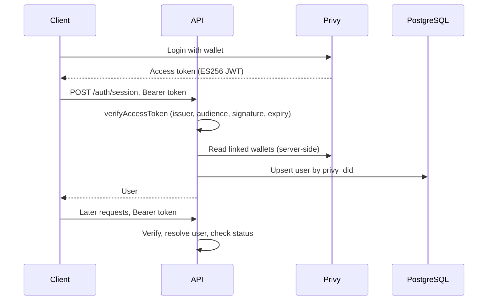
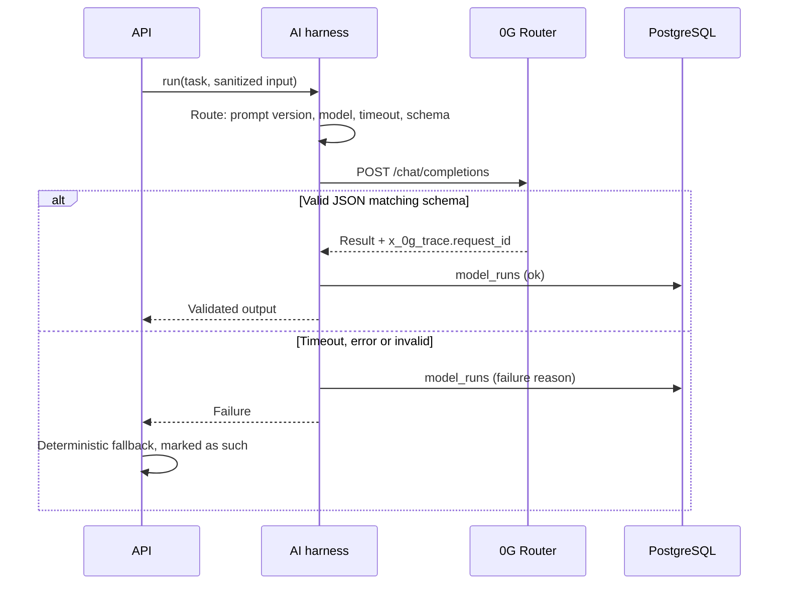
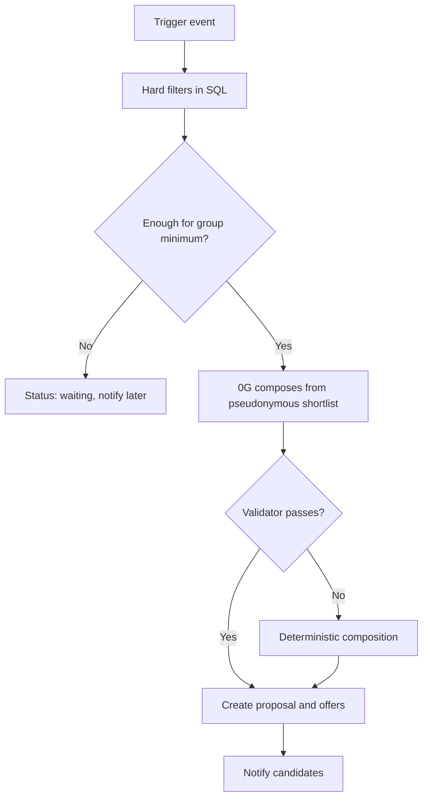
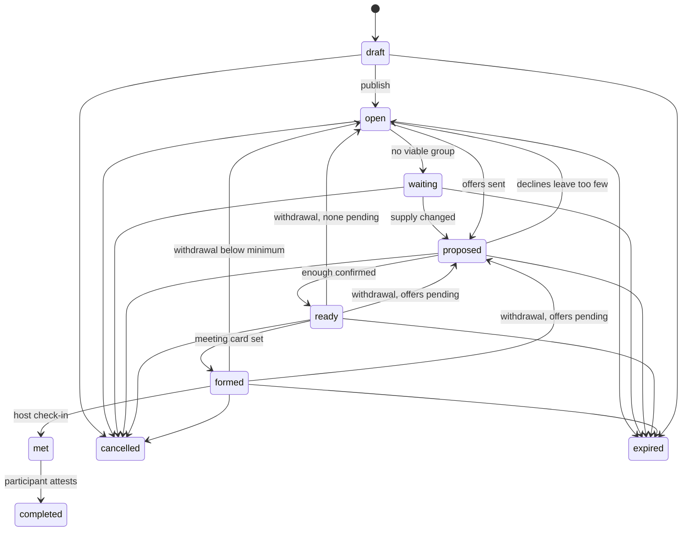
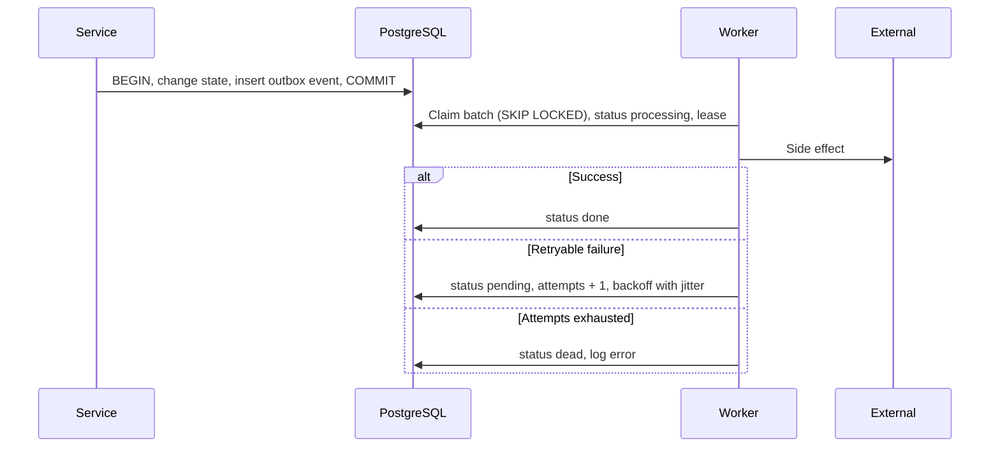
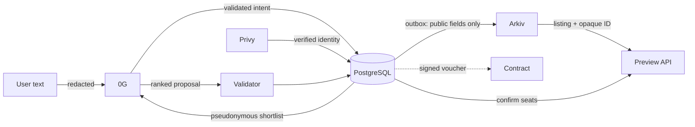

# Rally Backend Architecture

One TypeScript service owns all authority. External systems are adapters that can fail without
stopping the core product. Sections marked **Unverified** have not run against the real service.

## System overview



## Component responsibilities

| Component | Responsible for | Never does |
| --- | --- | --- |
| PostgreSQL (Supabase) | Private application data; authority for all transactional state | Serves as a public index |
| Arkiv | Public, queryable, expiring discovery listings | Allocates seats or stores personal data |
| 0G Compute | Intent parsing, question choice, group composition, explanations | Assigns seats, authorizes joins or writes to chain |
| Privy | Authentication and wallet identity | Determines Rally permissions |
| Smart contract (optional) | Reward claims against a funded pool | Controls matching or core flows |

## Backend architecture

`routes -> services -> repositories, domain, integrations`.

- **Routes** validate input and authenticate. **Services** own use cases and transactions.
- **Repositories** hold queries and take a `db` or transaction handle.
- **Domain** is pure logic: catalog, state machine, time and scoring.
- **Integrations** adapt Privy, Arkiv and 0G behind interfaces, so tests can use fakes.
- **Workers** run in the API process for the hackathon, using `WORKERS_ENABLED`. The design is safe
  with several instances because claims use `FOR UPDATE SKIP LOCKED`. Arkiv writes additionally use a
  PostgreSQL advisory lock so that only one writer uses the relayer nonce.

## Database architecture



| Table | Purpose |
| --- | --- |
| `users` | Privy DID, server-verified wallet, status, matching consent |
| `profile_versions` | Append-only profile: interests, declared and inferred tags, evidence, availability |
| `onboarding_answers` | Answers to at most three questions |
| `user_blocks` | Hard filter for matching |
| `intents` | Parsed activity intent, including waiting interest; raw text stays private |
| `rallies` | The activity: window, zone, capacity, `open_seats`, status, `version`, private meeting point |
| `rally_slots` | Each seat and its role |
| `claims` | A held seat; this is the participant record |
| `match_proposals` | A composed group, its reasons, source and model run |
| `offers` | One candidate's invitation and consent |
| `feedback` | Attestations, vouches and encore wishes |
| `reward_ledger` | Off-chain points; idempotent, audited, policy-versioned |
| `notifications` | Persistent in-app inbox |
| `outbox_events` | Transactional outbox |
| `arkiv_entities` | Entity key, last transaction, sync state per rally |
| `model_runs` | 0G trace: request ID, model, provider, prompt version, latency, tokens, outcome |
| `idempotency_keys` | Stored responses for retried commands |
| `reward_vouchers` | Issued claim vouchers and their nonces (optional feature) |

Decisions:

- The brief's `activities` and `activity_participants` are `rallies` and `claims`, matching the
  playbook. Its `proposals` are `match_proposals` plus `offers`, since consent belongs to a person.
- **`open_seats` and slots both exist on purpose.** Slots carry roles and let a unique index prevent
  double allocation. The counter is a fast read, guarded by a `CHECK` and updated in the same
  transaction.
- Offers do not reserve seats. More people may be offered than there are seats, which is how backups
  work, and a seat is taken only on acceptance.
- Enforced by the database: one active claim per slot, one active claim per user per rally, one
  pending offer per user per rally, and `0 <= open_seats <= capacity`.
- No soft delete. Lifecycle statuses and retained evidence serve that purpose.
- `optimistic rally version`: `version` increases with each change, and `PATCH` requires
  `expectedVersion`. Seat allocation uses row locks.

## API architecture

Base format is described in `CLAUDE.md`. Interactive documentation is served at `/docs`.

| Method and path | Auth | Purpose |
| --- | --- | --- |
| `GET /health`, `GET /health/ready` | Public | Liveness, readiness |
| `POST /auth/session` | Token | Verify Privy, upsert user |
| `GET /me` | Yes | Current user and profile |
| `PATCH /me/profile` | Yes | New profile version; triggers re-evaluation |
| `POST /me/blocks`, `DELETE /me/blocks/:userId` | Yes | Manage blocks |
| `GET /me/rewards` | Yes | Points balance and ledger |
| `POST /me/rewards/:id/voucher` | Yes | Signed claim voucher; optional feature |
| `POST /onboarding/questions` | Yes | Up to three questions |
| `POST /onboarding/complete` | Yes | Interests and answers; starts matching |
| `POST /intents/parse` | Yes | Natural language to structured intent |
| `GET /intents` | Yes | My intents |
| `POST /intents/:id/activate`, `POST /intents/:id/cancel` | Yes | Keep or drop waiting interest |
| `POST /rallies` | Yes | Create a draft, or create and publish |
| `GET /rallies` | Yes | Rallies I created or joined |
| `GET /rallies/:id` | Yes | Details if creator, participant or offered |
| `PATCH /rallies/:id` | Creator | Update details, capacity, meeting point |
| `POST /rallies/:id/publish` | Creator | Draft to open |
| `POST /rallies/:id/cancel` | Creator | Cancel and release seats |
| `POST /rallies/:id/withdraw` | Participant | Release my seat |
| `GET /rallies/:id/participants` | Member | Participants |
| `GET /rallies/:id/room` | Member | Meeting card once formed |
| `POST /rallies/:id/check-in` | Creator | Host-attested presence |
| `POST /rallies/:id/feedback` | Participant | Outcome, vouch, encore |
| `GET /activities/preview` | Public | Arkiv discovery, cross-checked against PostgreSQL |
| `GET /matches`, `GET /matches/:id` | Yes | Proposals and wait state |
| `POST /matches/:id/respond` | Candidate | Accept or decline |
| `GET /notifications` | Yes | Inbox |
| `POST /notifications/:id/read`, `POST /notifications/read-all` | Yes | Mark read |
| `GET /internal/metrics` | Admin token | Outbox, sync and pilot metrics |

Expiry is run by the scheduler rather than a client route. Available seats change through acceptance,
withdrawal, cancellation and capacity updates.

## Authentication flow



- `@privy-io/node` verifies tokens. Set `PRIVY_VERIFICATION_KEY` to verify locally; otherwise the SDK
  fetches the JWKS.
- Identity comes from the token `sub`. Bodies are never trusted. An invalid token returns 401.
- If Privy's user API fails during session creation, the session still succeeds and any known wallet
  is kept. A verified wallet is required later only for reward vouchers.

## Intent processing with 0G



Tasks, each with a versioned prompt and strict Zod schema: `onboarding_questions`, `parse_intent` and
`compose_group`. The human-readable explanation is part of `compose_group`, or generated
deterministically for fallback groups, so a match costs one call as the playbook budgets. Declines use
the normal engine, within the playbook's zero-to-one call budget. Follow-up answers refine the plan
through the editable fields on `POST /rallies`, since a new activity is budgeted one call.

`qwen3.7-flash` ran the full journey live. Choose the model with `ZERO_G_MODEL`.

Measured on the live Router, November 2026:

- **`response_format` breaks requests.** It returned `no_available_provider` (503) or `provider_error`
  (502) for every model tried, including ones the catalog lists as supporting it. The same requests
  without it returned 200. Prompts therefore ask for JSON, and the harness validates strictly.
- **Latency was 7 to 24 seconds** per task with qwen3.7-flash, so `AI_TIMEOUT_MS` defaults to 60 seconds.
  `POST /intents/parse` waits on this, so clients need a real processing state.
- Replies may be wrapped in markdown fences or leading newlines depending on the model. The harness
  strips them.
- The trace matches the docs for `request_id` and `provider`. Billing differs: `currency: "usd"` and
  `total_cost_usd_micro`, recorded as `usd_micro`.
- `X-0G-Provider-Trust-Mode: verified` returned `no_provider_for_trust_mode`. Standard routing works.

Fallbacks: questions use a fixed template per interest. Parsing uses a rule-based parser and returns
`source: "fallback"` and `needsReview: true`, so the client shows the editable form. Composition uses
the deterministic scorer. No fallback invents a person or a seat.

User text is delimited and declared as data in the prompt, and exact-location-like details are never
sent because only structured fields cross the boundary for composition. Parsing must see the user's
sentence, which is why emails, phone numbers and URLs are redacted first. The parser's output is
checked against the catalog.

### Two AI paths

`backend/AI.md` and `AI_ARCHITECTURE.md` describe the Formation Engine (`app.formation`,
`services/formation.ts`), built by the AI owner and agreed as what backend routes should call. Product
routes do not call it yet: they use `services/ai-harness.ts`. Both were developed at the same time, and
they share configuration.

| | AI harness (used by routes today) | Formation Engine (`app.formation`) |
| --- | --- | --- |
| Persistence | `model_runs` table | Log traces |
| Request ID | `x_0g_trace.request_id` | Response `id` |
| Parsing | One call, then the editable form | `ready` or `needs_answers`, with one reparse |
| Composition | Deterministic fallback | `no_fit`, or a typed failure |
| Tested live | Full journey through the routes | Its own four-step demo |

**This needs a decision: consolidate on one.** Until then, a prompt change in one is not reflected in
the other.

## Arkiv storage and querying

Public entity (schema `rally-mumbai.activity.v1`, owned by the relayer):

| Column | Indexed | Note |
| --- | --- | --- |
| `app` | yes | Application namespace |
| `event` | yes | Event tag |
| `opaqueId` | yes | Random `rly_...`, unrelated to the private ID |
| `category` | yes | Catalog value |
| `zone` | yes | Coarse zone |
| `startBucket` | yes | Hour, e.g. `2026-11-06T14` |
| `neededRole` | yes | Role category |
| `openSeats` | yes | Approximation |
| `minGroupSize` | no | |
| `status` | yes | `open`, `filling`, `full`, `closed` |
| `$expiresAt` | system | Replaces the playbook's `expiresAtBlock` |

- Writes only come from the outbox, after commit. The `arkiv.sync` handler reads current PostgreSQL
  state, then creates, patches or deletes, so retries converge and replays are harmless.
- **No duplicate entities after a crash.** Before creating, the handler queries by `opaqueId` under
  the relayer, and adopts an existing entity's key.
- Public status never reveals private lifecycle. `proposed`, `ready` and similar map to coarse values.
- Reads use `.ownedBy(relayer)`, the indexed filters, `limit`, and key-based cursors, because `offset`
  can repeat or miss rows during writes.
- A preview cross-checks each listing against PostgreSQL by `opaqueId`, and removes stale ones.
- A reconciler repairs drift: unsynced rallies are re-enqueued, and active rallies with no entity are
  created. Terminal rallies have their entities deleted.
- Private and sensitive rallies never get an entity.

### Verified from SDK 1.0.1 source and documentation

Rabdi: chain ID 7794095, 2-second blocks, gas in tGLM. 32 attributes per entity (31 with a named
schema), 128-byte strings, 128 KiB of `bytes` per create or patch, 100 rows per page, maximum lifetime
of 7,884,000 blocks. There is no `updateEntity`: use `patchEntity`. Patches keep expiry, and
`extendEntity` cannot shorten it. Expiry emits no event. Entities are publicly writable under any
schema name, so filter by owner.

### Needs confirmation from the Arkiv team

The team's informal statements are recorded as such, and nothing depends on them.

| Topic | Stated by team | Documentation or status |
| --- | --- | --- |
| Query page size | 40 | Docs and SDK say 100, and live Rabdi accepted 100. `ARKIV_QUERY_PAGE_SIZE` defaults to 40 |
| Query latency | About 2 seconds | 200 to 630 ms in single live queries; unmeasured under load. Writes took about 6 seconds |
| Attributes | 32 | Matches docs; 31 with a named schema |
| Wallet storage | About 40 pages per user | Not documented; a shared relayer may reach any wallet limit sooner than a per-user estimate suggests |
| Testnet cost | Not a concern | Not measured |
| Community RPC | May be faster | Not tested. `ARKIV_RPC_URL` allows an override |

Still to validate: maximum entity size in bytes, wallet-level storage limits, write throughput per
relayer, transaction costs, query latency under load, community RPC reliability, and expiry and
deletion semantics in chain history.

## Matching architecture

Two triggers, one engine: `rally.published` and `user.onboarded`. Availability changes, withdrawals
and new supply also enqueue re-evaluation.



Hard filters: same category; window overlap covering the duration; allowed zone; rally status, expiry
and seats; opted-in active user; no block in either direction with any current member; no existing
claim, pending offer or earlier offer on this rally; no overlapping active commitment.

A model call happens only for a viable group, and anyone offered a seat leaves the candidate set. So
a rally spends another call only when its feasible candidates have actually changed, as the playbook
requires, and nothing needs to track that separately.

The score follows the playbook, as a heuristic and not a probability: feasibility 45%, complementary
fit 30%, acceptance likelihood 15%, prior mutual encore 10%.

Validator rules for AI output: members must be a unique subset of the shortlist; the group must fit
open seats and reach the group minimum; roles must come from the rally's open slots. IDs are `c1`,
`c2` and so on, mapped back server-side, so real user IDs never cross the boundary.

## Atomic acceptance and reservation

```mermaid
sequenceDiagram
  participant U1 as User A
  participant U2 as User B
  participant DB as PostgreSQL
  U1->>DB: BEGIN, lock user, lock rally FOR UPDATE
  U2->>DB: BEGIN, lock user, wait for rally lock
  U1->>DB: Validate offer, status, expiry, schedule
  U1->>DB: Pick open slot, insert claim, open_seats - 1
  U1->>DB: Update offer, state; write outbox and notifications
  U1->>DB: COMMIT
  DB-->>U2: Rally lock acquired
  U2->>DB: Validate: no open seat
  U2->>DB: ROLLBACK
  DB-->>U2: 409 RALLY_FULL
```

- Lock order is user, rally, offer, so deadlocks cannot form between use cases. Locks are
  `FOR NO KEY UPDATE`, because plain `FOR UPDATE` blocks the foreign key checks of other transactions.
- Idempotent: an already accepted offer returns the same claim. Declining is similar. An accepted
  offer cannot be declined here; use withdraw.
- Partial unique indexes are the final defence; violations map to 409.
- Any error rolls back everything, including the outbox events.
- Arkiv is never consulted.

State transitions after a response: `open_seats = 0`, or no pending offers with claims at the group
minimum, moves the rally to `ready`. `ready` moves straight to `formed` if a meeting point exists;
otherwise it waits for the creator to set one. No pending offers and too few claims reopens the rally
and triggers another match.

## Activity state machine



## Outbox and workers



- At-least-once delivery, so every handler is idempotent. Deduplication uses a unique `dedupe_key`
  on the event, deterministic targets for writes, and unique keys on notifications and rewards.
- An expired lease returns a crashed worker's event to `pending`.
- A dead Arkiv event only marks the listing as out of sync, and the reconciler retries later.

| Outbox event | Handler | Playbook domain event |
| --- | --- | --- |
| `rally.published` | Matching for the rally | RallyPublished |
| `user.onboarded` | Matching for the user | UserOnboarded |
| `match.reevaluate` | Matching for a rally or user | ParticipantWithdrew, availability changes |
| `arkiv.sync` | Make the listing match PostgreSQL | RallyPublished and every seat or status change |
| `vouch.verified` | Profile evidence and capped points | VouchVerified |

MatchProposed, MatchAccepted and RallyCompleted need no event: their notifications are written in the
same transaction as the change, and seat revalidation happens synchronously on acceptance.

Scheduler jobs: expire rallies, offers, proposals and intents; reconcile Arkiv; delete old outbox rows,
idempotency keys and read notifications.

## Notifications

Notifications are written to the inbox in the same transaction as the state change, so they cannot be
lost. Clients poll `GET /notifications`. A unique `dedupe_key` prevents duplicates on retry.

## Smart contract responsibilities

Rally's MVP needs no contract. `contracts/` holds only the optional `RewardClaim` the playbook
specifies: funded pool, per-user nonce, expiry, authorized signer, chain ID and replay protection. The
backend signs vouchers only. A voucher is eligibility evidence, not proof of physical presence.

## Errors and retries

| Failure | Behaviour |
| --- | --- |
| Privy token rejected | 401; a wallet address from the UI is never trusted |
| 0G slow or unavailable | Timed fallback to the editable form; no invented matches |
| Arkiv unavailable | Preview returns `available: false` with a notice; invites still work |
| Last-seat race | One transaction and unique claim; loser gets `409 RALLY_FULL` |
| Notification failure | Inbox is transactional; there is no separate delivery to fail yet |
| Participant withdraws | Seat reopens, others notified; never auto-accepted |
| Prompt injection or PII | User text treated as data; schema validation; redaction |
| Sensitive category | Forced private; never on Arkiv |

Retry rules: exponential backoff with jitter for 429, 5xx and network errors. Authentication,
validation and insufficient-balance errors are not retryable for 0G; they fall back immediately.

## Privacy boundaries

| Data | PostgreSQL | Arkiv | 0G |
| --- | --- | --- | --- |
| Privy DID, wallet | Yes | Never | Never |
| Interests, answers | Yes | Never | Pseudonymous, minimal |
| Raw intent text | Yes | Never | Redacted, for parsing only |
| Exact meeting point | Yes, members only once formed | Never | Never |
| Category, broad zone, hour | Yes | Public rallies only | Yes |
| Offers, consent, feedback | Yes | Never | Never |

TTL removes entities from live queries, but not from chain history, which is why only public-safe data
is ever written.

## Data flow



## Deployment

- One Node.js process runs API and workers. Run `npm run build`, `npm run db:migrate:prod`, then
  `npm start`. Ship `drizzle/` with `dist/`.
- Set `DATABASE_URL` to Supabase's transaction pooler and `DATABASE_MIGRATION_URL` to its
  session pooler. The direct host is IPv6-only.
- Use `/health` for liveness and `/health/ready` for readiness.
- Set `TRUST_PROXY=true` behind your own proxy, or per-IP rate limits apply to the proxy.
- Row level security is on for every table with no policies, so Supabase's Data API exposes nothing.
  The service connects as the table owner and bypasses it. **Never give it a role that does not own
  the tables, and do not add permissive policies.** A test fails if a new table lacks RLS.
- `/docs` serves the API description publicly. It holds no data, but block it at your proxy if you
  would rather not publish it.

## Environment variables

Blank counts as unset. `.env.example` has a commented copy.

| Variable | Default | Purpose |
| --- | --- | --- |
| `NODE_ENV` | `development` | `production` makes CORS and Privy settings mandatory |
| `HOST`, `PORT` | `0.0.0.0`, `3000` | Listen address |
| `LOG_LEVEL` | `info` | Pino level |
| `DATABASE_URL` | required | Runtime connection |
| `DATABASE_MIGRATION_URL` | `DATABASE_URL` | Migrations only |
| `DATABASE_POOL_MAX` | `10` | Connection pool size |
| `CORS_ORIGINS` | none | Exact browser origins, comma-separated |
| `TRUST_PROXY` | `false` | Honour proxy headers |
| `RATE_LIMIT_MAX`, `RATE_LIMIT_WINDOW_MS` | `300`, `60000` | Per-IP limit |
| `SHUTDOWN_TIMEOUT_MS` | `15000` | Forced exit deadline |
| `WORKERS_ENABLED` | `true` | Run outbox and scheduler in this process |
| `OUTBOX_POLL_MS`, `SCHEDULER_INTERVAL_MS` | `1000`, `30000` | Worker pacing |
| `ADMIN_API_TOKEN` | none | Enables `GET /internal/metrics`; 32+ characters |
| `EVENT_ZONES` | three venue zones | Allowed zones |
| `OFFER_HOLD_MINUTES` | `30` | How long an offer stays open |
| `PRIVY_APP_ID`, `PRIVY_APP_SECRET` | none | Required in production. **Secret** |
| `PRIVY_VERIFICATION_KEY` | none | Verify tokens locally |
| `ZERO_G_API_KEY`, `ZERO_G_MODEL` | none | Without both, deterministic fallbacks. Key is **secret** |
| `AI_REQUIRED` | `false` | `true` fails startup when the two above are missing |
| `ZG_BASE_URL` | mainnet Router | Testnet: `https://router-api-testnet.integratenetwork.work/v1` |
| `ZG_TRUST_MODE`, `ZG_VERIFY_TEE` | unset, `false` | Private routing and attestation; test before claiming |
| `AI_TIMEOUT_MS` | `60000` | Then fall back |
| `AI_MAX_OUTPUT_TOKENS` | `4096` | Includes reasoning tokens |
| `ARKIV_PRIVATE_KEY` | none | Relayer wallet. Without it, discovery is off. **Secret** |
| `ARKIV_ACCESS_KEY` | none | RPC key. Without it, the heavily limited public endpoint |
| `ARKIV_RPC_URL` | Rabdi | Override, e.g. community RPC |
| `ARKIV_APP`, `ARKIV_EVENT`, `ARKIV_SCHEMA_NAME` | Rally values | Namespacing |
| `ARKIV_QUERY_PAGE_SIZE` | `40` | Up to 100 |
| `ARKIV_QUERY_TIMEOUT_MS` | `5000` | Then preview shows a notice |
| `REWARDS_CLAIMS_ENABLED` | `false` | Optional voucher signing |
| `REWARD_SIGNER_PRIVATE_KEY` | none | **Secret** |
| `REWARD_CLAIM_CONTRACT`, `REWARD_CHAIN_ID`, `REWARD_TOKEN_UNITS_PER_POINT` | none | Required when enabled |
| `REWARD_VOUCHER_TTL_MINUTES` | `60` | Voucher lifetime |

## Verification status

| Area | How it was checked |
| --- | --- |
| PostgreSQL, seat races, idempotency, outbox | Real PostgreSQL 18 with real concurrent requests |
| Privy token verification | Real SDK with locally signed ES256 tokens |
| Privy credentials | Live: junk token rejected, and the API accepted the app ID and secret |
| Privy login with a real user, and wallet lookup | **Unverified**: needs a real login from the client. Faked in tests |
| 0G inference in the main flow | Live: questions, intent parsing and composition, with request IDs (`npm run smoke:journey`) |
| Private or verified 0G routing | **Unverified**; verified routing currently returns no provider. Do not claim it |
| Arkiv queries and writes | Live on Rabdi: create, read, patch, extend, delete (`npm run arkiv:smoke -- --write`) |
| Full journey | Live 0G and Arkiv on a throwaway database, with simulated login |
| Supabase | Live: migrations through the session pooler, server readiness, row and advisory locks through the transaction pooler, and the `anon` role seeing no rows. Seat races ran on PostgreSQL 18 locally, not on Supabase's 17 |
| RewardClaim contract | Foundry unit and fuzz tests, local Anvil deployment, shared signature fixture |

## Not implemented

The playbook marks these optional or describes them loosely. They were left out rather than stubbed.

- Web Push, and SSE. In-app notifications use polling, which the playbook allows.
- Chat in the temporary room. The room is the meeting card and member list.
- Encore prefill of a future rally. Mutual encores do feed the match score.
- Reward corrections and vouch disputes, which need an admin flow. Flagged vouches earn nothing.
- "N exploring" counts on preview cards. Cards show open seats.
- Admin tooling beyond `GET /internal/metrics`.

## Assumptions needing confirmation

0G:

- Private or verified routing must be tested with a real key before it is claimed.
- Model availability and JSON mode, read from the live catalog, may change.
- Whether `response_format` failing is a temporary Router issue or expected behaviour.

Others: see the Arkiv table above. Which chain and asset any reward contract targets is undecided.
