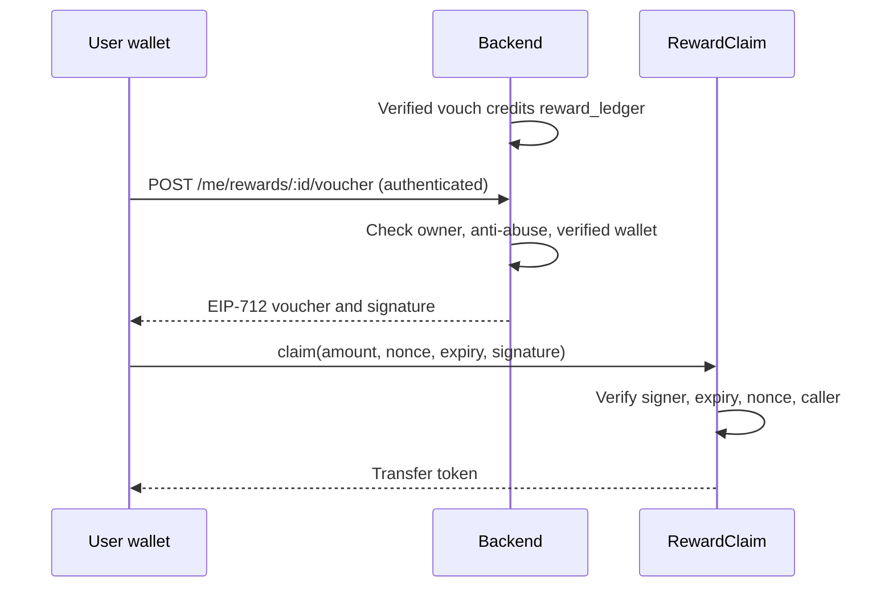

# Rally Contracts

Core Rally needs no smart contract. Everything here is optional, and the backend works without it.

| Contract | Purpose | Status |
| --- | --- | --- |
| `RallyToken` | Non-transferable RALLY points token | Arc Testnet: `0xb34c92f18E76EAb1a93a9ACDf4e677685498826B` |
| `RallyLedger` | Public history of point changes and dispute rulings | Arc Testnet: `0xf36Fab5B39f0741Ee549B83Aefa64af7BbE9F642` |
| `RewardClaim` | Stablecoin payouts for earned points | Not deployed, not planned |

## RallyLedger and RallyToken

`RallyLedger` deploys `RallyToken` in its constructor and is the only account that can mint or burn it.
Rally's database is the source of truth, and the backend mirrors it here through the outbox worker.

- **Earned only:** no premine or sale. Transfers and approvals revert.
- **Negative balances:** a penalty burns what it can and adds the rest to `debt`. Earnings repay debt
  first. `netOf(address)` returns balance minus debt.
- **Policy versions:** every `record` must match a published amount, and published versions never change.
  Amounts are limited to 100 either way, whatever the policy role publishes.
- **Retries:** a used `key` is a no-op, so a retried transaction cannot double-mint.
- **Privacy:** only addresses, action codes, outcomes and salted hashes go on-chain.

| Role | Held by | Can do |
| --- | --- | --- |
| `DEFAULT_ADMIN_ROLE` | Admin address | Grant and revoke roles, pause |
| `POLICY_ROLE`, `WRITER_ROLE`, `RESOLVER_ROLE` | Backend relayer | Publish policies, record points and rulings |

If the relayer key leaks, it can write false records within policy limits until the admin pauses the
ledger or revokes its roles. The code has tests but no audit.

### Deploying to Arc Testnet

Gas is paid in testnet USDC from [Circle's faucet](https://faucet.circle.com).

```sh
RALLY_ADMIN=0x... RALLY_OPERATOR=0x... \
  forge script script/DeployLedger.s.sol --rpc-url https://rpc.testnet.arc.network \
  --private-key $RELAYER_KEY --broadcast
```

Then set the `ARC_*` variables in the backend, and run `npm run smoke:arc` from `backend/` to check the
gateway against the deployed contract.

## RewardClaim

Not in use: `REWARDS_CLAIMS_ENABLED` stays `false`, because RALLY has no payouts. A pool, funded by the team, that pays rewards already earned in the backend's off-chain ledger. It
is explicit settlement, not a token mint.

| Playbook requirement | Implementation |
| --- | --- |
| Funded pool | Pays any ERC-20 set at deployment, such as USDC. The owner can withdraw the rest |
| Per-user nonce | `usedNonces[account][nonce]` |
| Expiry | `expiry` in the signed voucher |
| Authorized signer | `signer`, rotatable by the owner |
| Chain ID and replay protection | EIP-712 domain binds chain ID and contract address |
| Wallet ownership verified | Only `account` can submit its own voucher |

The owner can also pause claims. A voucher shows that the backend considers an account eligible; it
is not proof of physical presence.

### Trust assumptions

- The signer key can authorize any amount, up to the pool balance, until rotated or paused. Keep the
  pool small, and keep the key server-side.
- The owner can withdraw everything. Use a multisig for real funds.
- This code has tests but no audit.

### Backend interaction



The backend derives one nonce per ledger entry, and keeps the same wallet when replacing a lapsed
voucher, so a replacement cannot pay out twice. The voucher format is defined in both
`src/RewardClaim.sol` and `backend/src/services/reward-voucher.ts`. A shared fixture in both test
suites fails if they drift apart.

## Development

Requires [Foundry](https://getfoundry.sh).

```sh
forge soldeer install   # install dependencies
forge build
forge test
forge coverage
```

## Deployment

**Do not deploy `RewardClaim` to a public network without explicit authorization.** No chain or payout
token has been chosen for it.

Try it on a local Anvil chain:

```sh
anvil
REWARD_TOKEN=0x... REWARD_SIGNER=0x... REWARD_OWNER=0x... \
  forge script script/Deploy.s.sol --rpc-url http://127.0.0.1:8545 --private-key <anvil key> --broadcast
```

After deploying, fund the contract with the token, and set in the backend:
`REWARDS_CLAIMS_ENABLED=true`, `REWARD_SIGNER_PRIVATE_KEY`, `REWARD_CLAIM_CONTRACT`,
`REWARD_CHAIN_ID` and `REWARD_TOKEN_UNITS_PER_POINT` (for example, `10000` pays 0.01 USDC per point).
