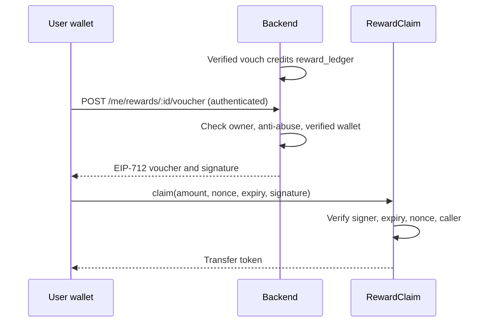

# Rally Contracts

**Rally's MVP needs no smart contract, and nothing here is deployed.**

The playbook is explicit: Phase 1 works with zero reward contracts, on-chain settlement must not
control matching, and on-chain rewards should be skipped entirely if they threaten stability. Arkiv
writes use the Arkiv SDK and need no contract of ours.

`RewardClaim` is the one optional contract the playbook specifies (Gate D). Delete this folder's
contract if the team does not pursue on-chain rewards; the backend works the same with
`REWARDS_CLAIMS_ENABLED=false`, which is the default.

## RewardClaim

A pool, funded by the team, that pays rewards already earned in the backend's off-chain ledger. It
is explicit settlement, not a token mint.

| Playbook requirement | Implementation |
| --- | --- |
| Funded pool | Pays any ERC-20 set at deployment, such as USDC. The owner can withdraw the rest |
| Per-user nonce | `usedNonces[account][nonce]` |
| Expiry | `expiry` in the signed voucher |
| Authorized signer | `signer`, rotatable by the owner |
| Chain ID and replay protection | EIP-712 domain binds chain ID and contract address |
| Wallet ownership verified | Only `account` can submit its own voucher |

The owner can also pause claims. A voucher shows that the backend considers an account eligible; it
is not proof of physical presence.

### Trust assumptions

- The signer key can authorize any amount, up to the pool balance, until rotated or paused. Keep the
  pool small, and keep the key server-side.
- The owner can withdraw everything. Use a multisig for real funds.
- This code has tests but no audit.

### Backend interaction



The backend derives one nonce per ledger entry, and keeps the same wallet when replacing a lapsed
voucher, so a replacement cannot pay out twice. The voucher format is defined in both
`src/RewardClaim.sol` and `backend/src/services/reward-voucher.ts`. A shared fixture in both test
suites fails if they drift apart.

## Development

Requires [Foundry](https://getfoundry.sh).

```sh
forge soldeer install   # install dependencies
forge build
forge test
forge coverage
```

## Deployment

**Do not deploy to a public network without explicit authorization.** The target chain and token are
not decided: the playbook mentions Arc as a possibility, and needs confirming.

Try it on a local Anvil chain:

```sh
anvil
REWARD_TOKEN=0x... REWARD_SIGNER=0x... REWARD_OWNER=0x... \
  forge script script/Deploy.s.sol --rpc-url http://127.0.0.1:8545 --private-key <anvil key> --broadcast
```

After deploying, fund the contract with the token, and set in the backend:
`REWARDS_CLAIMS_ENABLED=true`, `REWARD_SIGNER_PRIVATE_KEY`, `REWARD_CLAIM_CONTRACT`,
`REWARD_CHAIN_ID` and `REWARD_TOKEN_UNITS_PER_POINT` (for example, `10000` pays 0.01 USDC per point).
